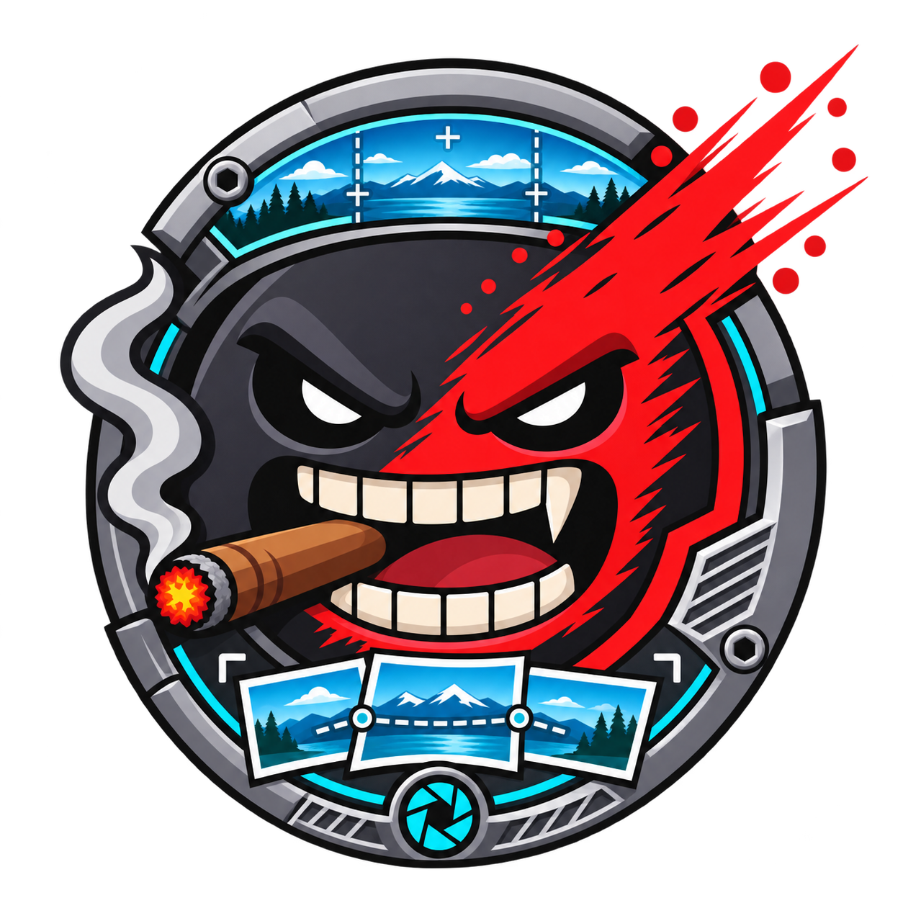
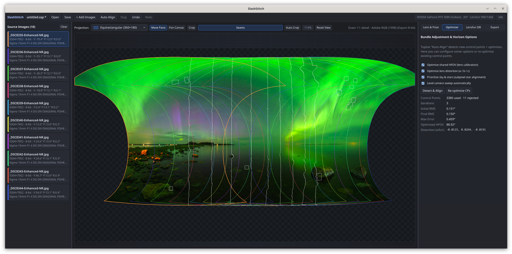
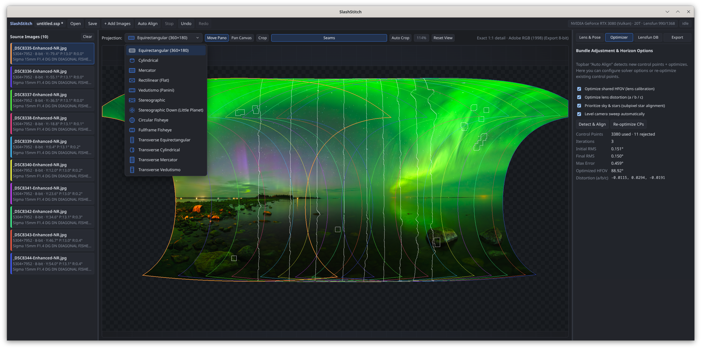
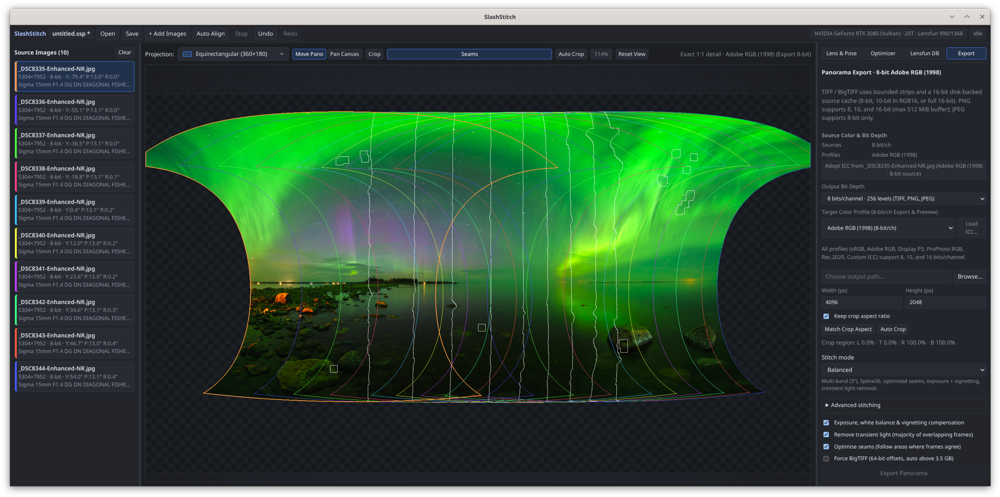

<p align="center">
  
</p>

<h1 align="center">SlashStitch</h1>

<p align="center">
  An open-source panorama workbench for landscapes, night skies and the images in between.
</p>

<p align="center">
  <a href="https://github.com/slashmad/SlashStitch/releases/latest">Download</a> ·
  <a href="docs/USER_GUIDE.md">User guide</a> ·
  <a href="https://github.com/slashmad/SlashStitch/issues">Report a problem</a>
</p>


SlashStitch brings image alignment, lens correction, projection, cropping and panorama export
into one desktop application. A native Rust engine handles the image processing; the Electron
and React interface provides a live workbench with GPU preview and full-resolution detail.



> **Status: early development, 0.2.1.** Linux has been exercised with real image sets and
> local desktop tests. The build workflow also runs native worker tests and produces Windows
> and macOS packages. Building and automated tests do not qualify every GPU, driver or desktop
> environment. Windows and macOS installers are unsigned; macOS builds are not notarized.

## What it does

- **Align overlapping photographs:** feature matching, rotation RANSAC and robust bundle
  adjustment, with optional lens calibration, horizon leveling and sky/star weighting.
- **Choose the view:** 13 panorama projections, including equirectangular, cylindrical,
  Mercator, rectilinear, Panini, stereographic, fisheye and transverse variants.
- **Inspect the stitch:** fast GPU preview with CPU fallback, an exact preview after
  interaction pauses, full-resolution detail when zoomed in, and source-frame/seam overlays.
- **Blend and correct:** multi-band or feather blending, content-aware seams, exposure and
  white-balance matching, vignetting correction and optional transient-light rejection.
  Balanced, Night sky & aurora, Sharp detail and Fast draft presets group the settings.
- **Control colour and precision:** 8-, 10- or 16-bit output with sRGB, Adobe RGB, Display P3,
  ProPhoto RGB, Rec.2020 or a supported custom/source RGB ICC profile.
- **Develop camera RAW:** ARW, CR2/CR3, NEF, RAF, ORF, RW2, PEF, DNG and other RAW files
  are developed in floating point to a wide-gamut 16-bit source. Lightroom/ACR white balance,
  exposure and orientation from XMP sidecars (or a DNG's embedded XMP) are applied; other
  Lightroom adjustments are listed per image instead of being guessed.
- **Export panoramas:** at full resolution by default (the source images' pixel density at
  their centres, so no detail is lost) or a chosen fraction, as TIFF/BigTIFF, PNG and JPEG,
  with cancellation, atomic output and protection against overwriting source photographs.
  Large TIFFs render in strips.
- **Save the work:** `.ssp` projects, relative source paths, Undo/Redo, crash-recovery
  snapshots and a restartable worker. Sources remain separate from the project document.
- **Use lens profiles:** Lensfun discovery and optional app-private database updates,
  without replacing the system or user database.

<details>
<summary>More screenshots: projections and export</summary>





</details>

## Download and run

Download matching files from [Releases](https://github.com/slashmad/SlashStitch/releases).
The desktop interface and Rust worker are included; Node.js and Rust are only needed to build
from source.

| Platform | Packages |
|---|---|
| Linux x64 | AppImage, Debian/Ubuntu `.deb`, Fedora/RPM `.rpm` |
| Windows x64 | Setup installer, portable `.exe`, `.zip` |
| macOS Apple Silicon | arm64 `.dmg`, `.zip` |
| macOS Intel | x64 `.dmg`, `.zip` |

Check the architecture in the filename. SHA-256 checksums accompany the release assets.
Unsigned packages may require approval from Windows SmartScreen or macOS Gatekeeper.

For the Linux AppImage:

```sh
chmod +x SlashStitch-0.2.1-linux-x64.AppImage
./SlashStitch-0.2.1-linux-x64.AppImage
```

If FUSE mounting is unavailable, use `--appimage-extract-and-run`. Display libraries and GPU
drivers still come from the host. The Linux Rust worker targets GLIBC 2.28; this is an ABI
baseline for that binary, not a guarantee for every Linux desktop.

## First panorama

1. Add overlapping JPEG, PNG, TIFF, WebP or camera RAW/DNG images, or drop a folder onto the window.
2. Choose **Auto Align** and inspect the result. Moving skies, water and nearby foreground
   can need different compromises; a low control-point error does not make moving content identical.
3. Pick a projection, adjust the view and crop. Toggle **Seams** to inspect the contributing frames.
4. In **Export**, keep **Full resolution** (or pick a smaller size), choose a stitch preset,
   colour profile and bit depth, then save the panorama.
5. Save an `.ssp` project to return to the alignment and settings later. Keep its source images.

The [user guide](docs/USER_GUIDE.md) covers shortcuts, lens models, colour management,
resource limits, recovery and advanced stitching.

On Windows, DirectX 12 is the default preview backend. If graphics initialization crashes or
stalls before the engine is ready, SlashStitch retries once with CPU rendering. **Restart with
CPU** is also available after an engine disconnection. `SLASHSTITCH_FORCE_CPU=1` starts directly
without GPU initialization; `WGPU_BACKEND` can override the backend for driver diagnostics.

## Formats and current limits

Sources retain up to 16 bits per channel. **10-bit output uses 1024 levels stored in RGB16.**
JPEG supports 8 bits per channel. Higher-bit-depth export cannot recover detail absent from
8-bit originals. RGB ICC profiles are supported; LUT-only output profiles without RGB tone
curves are rejected. Transparent and non-RGB sources must be flattened or converted first.
Camera RAW development is neutral: RCD demosaicing (Fujifilm X-Trans sensors use a simpler
bilinear method), as-shot (or Lightroom) white balance, the camera colour matrix, exposure and
a smooth highlight shoulder, without a camera "look", contrast curve or noise reduction.
Lightroom tone, presence, HSL, colour grading, profiles, crops and local adjustments are not
reproduced; each image lists what was applied and what was not. A DNG's enhanced image (e.g.
Lightroom Denoise) is used when it can be decoded; otherwise the original sensor data is
developed and the image info says so. RAW support has been exercised with Sony ARW and
Lightroom DNG files; other cameras rely on rawler's format support. Exposure brackets are
detected and shown, but merging them into HDR is not implemented yet: bracketed frames are
stitched individually.
Development sample photographs and camera originals are not distributed.

Large sources use a disk cache and memory reservations. Limits adapt to memory and disk space;
maximum source counts and dimensions are safeguards, not promises that every maximum-size
project fits. Initial cache creation can take time and substantial disk space. Full-resolution
control-point refinement remains future work.

## Build from source

Use Node.js 22+, npm, Rust/Cargo and the native build tools for your OS. Linux release builds
also need Zig, cargo-zigbuild and objdump:

```sh
npm ci
cargo install cargo-zigbuild --version 0.24.1 --locked --root "$PWD/.build-tools"
python3 -m venv .build-tools/python
.build-tools/python/bin/pip install ziglang==0.17.1
npm run build
npm start
```

On Windows use the MSVC Rust toolchain and Visual Studio C++ build tools. On macOS use the
native Rust toolchain and Xcode command-line tools. Omit the Linux-only tool setup there.

```sh
npm run typecheck
npm test
npm run pack          # unpacked native application
npm run dist:linux    # Linux host: AppImage, deb, rpm
npm run dist:win      # Windows host: setup, portable, zip
npm run dist:mac      # macOS host: dmg, zip
npm run release:checksums
```

Installer builds reuse the Electron distribution installed by `npm ci` and a release worker
verified for the same OS and architecture. Cross-packaging another OS's worker is rejected.
GitHub Actions builds the four platform/architecture combinations separately. On Linux,
`npm run smoke` and `npm run smoke:regressions` use a private headless Weston session.

## License and credits

SlashStitch is [MIT licensed](LICENSE). Electron/Chromium and Rust dependency notices are
included in the packages. Lensfun and other third-party components retain their own licenses.
Camera RAW decoding uses [rawler](https://github.com/dnglab/dnglab) (LGPL-2.1), statically
linked into the worker; its license text ships with the packages, and because SlashStitch's
complete source is public, the worker can be rebuilt against a modified rawler.
The native engine uses wgpu, Rayon, image, moxcms and nalgebra alongside the desktop interface.

## Support

If SlashStitch is useful to you, you can support its development:

[](https://github.com/sponsors/slashmad)
[](https://ko-fi.com/slashmad)
[](https://liberapay.com/slashmad/)
